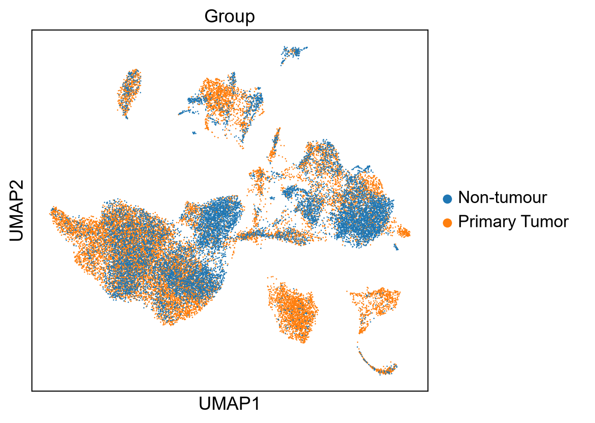
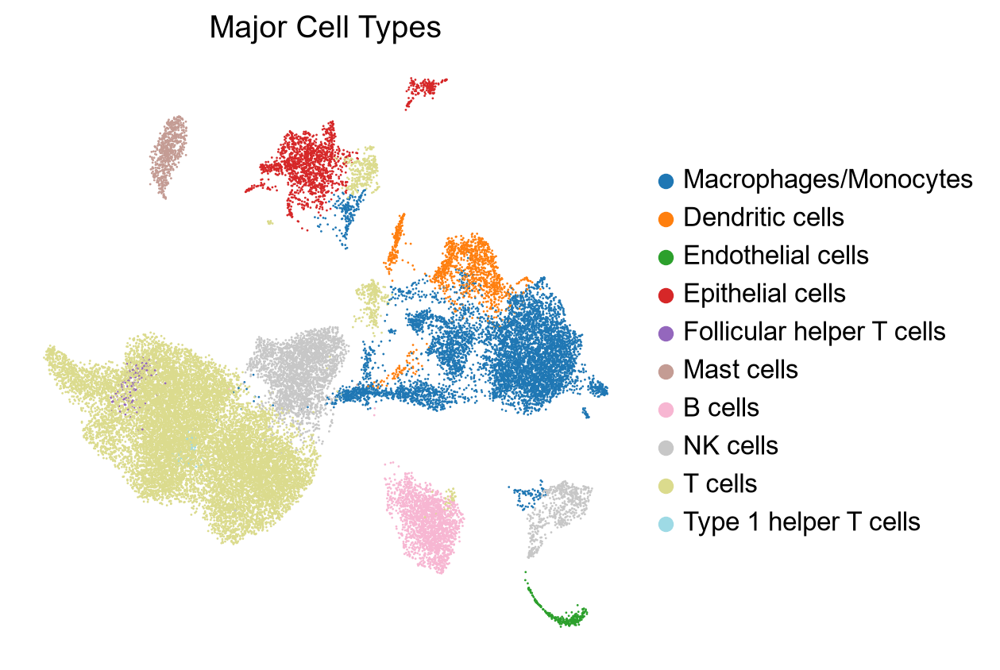
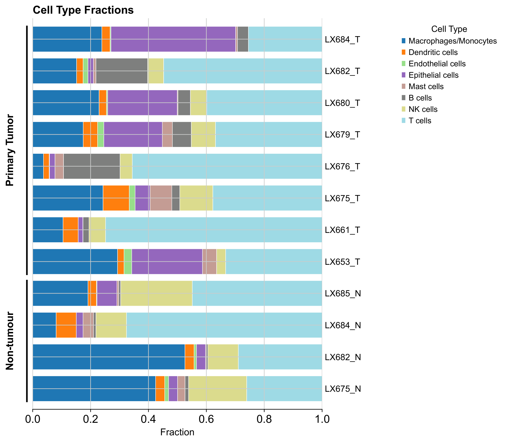
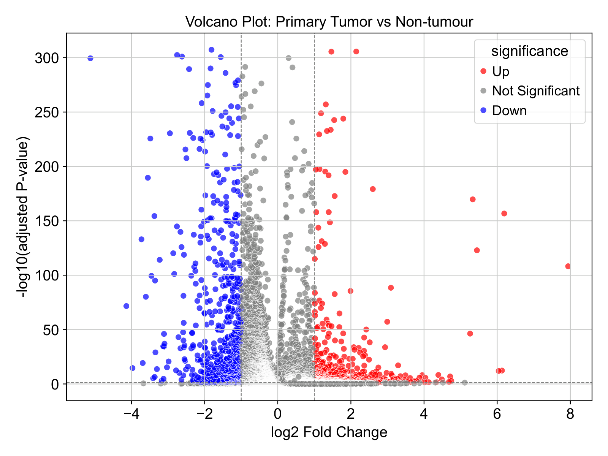
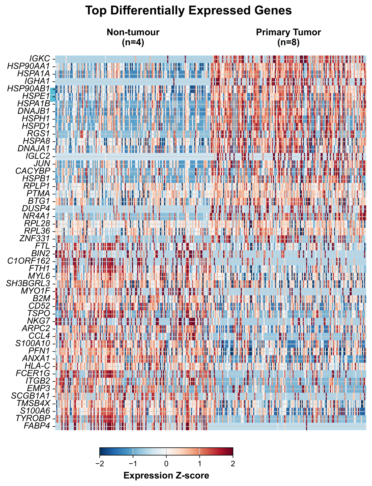
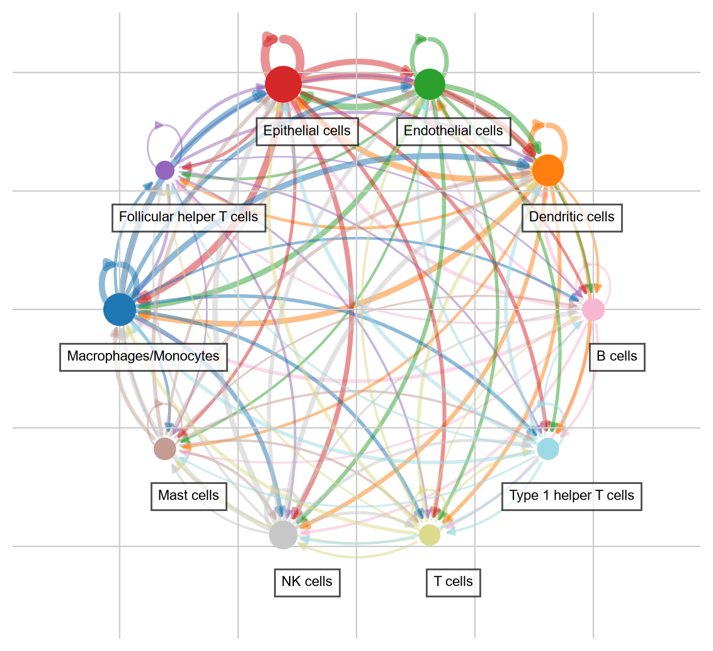
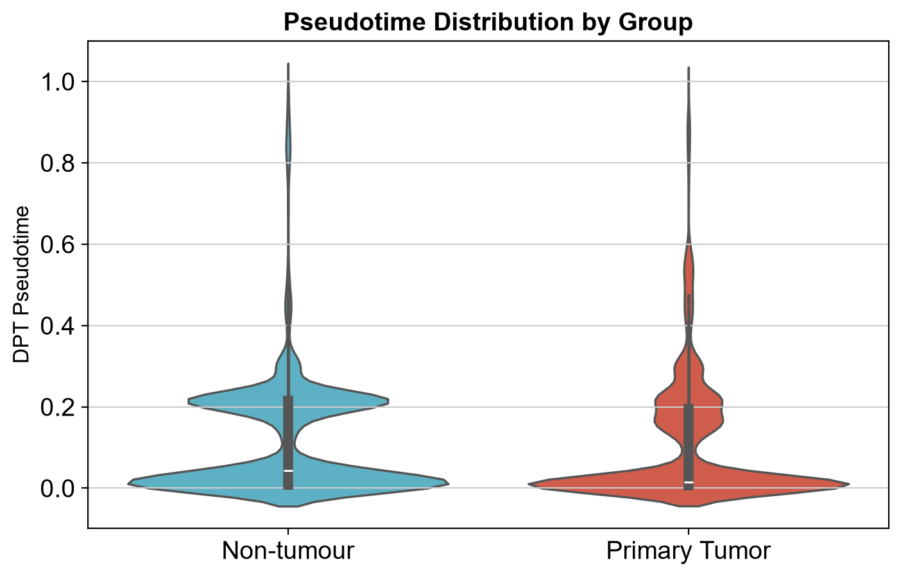
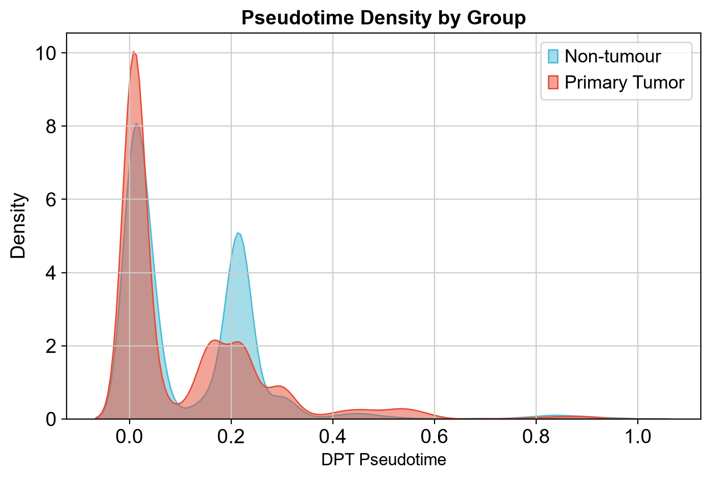

# Single-Cell Transcriptomics of the Lung Tumour Microenvironment

**GSE123902 · primary lung adenocarcinoma vs. non-tumour lung · 41,384 cells · 12 samples**

A reproducible Scanpy pipeline that goes from raw per-sample `.h5ad` files to annotated cell types, differential expression, cell–cell communication and pseudotime — built as an end-to-end exercise in single-cell analysis rather than a narrow re-implementation of one figure.

---

## Overview

The tumour microenvironment (TME) of lung adenocarcinoma differs from adjacent non-tumour lung not only in its cell-type composition but also in the transcriptional state of the cells that are present. This repository asks four questions of a public 10x Genomics dataset:

1. **Identity** — which cell types are present in the integrated tumour + non-tumour landscape, and where do the two conditions sit on the map?
2. **Composition** — how do cell-type proportions differ between tumour and non-tumour samples?
3. **Transcriptional shift** — which genes distinguish tumour from non-tumour cells once samples are integrated?
4. **Communication & trajectory** — which ligand–receptor programmes connect the cell types, and do cells from the two conditions occupy different positions along a pseudotime axis?

Everything below is produced by one notebook (`scRNA_pipeline.ipynb`) plus the figures in `figures/`.

---

## Dataset

| Item | Value |
|---|---|
| Source | [GEO: GSE123902](https://www.ncbi.nlm.nih.gov/geo/query/acc.cgi?acc=GSE123902) |
| Tissue | Primary lung adenocarcinoma and non-tumour-involved lung |
| Samples used | **8 primary tumour** (`LX653/LX661/LX675/LX676/LX679/LX680/LX682/LX684_T`) + **4 non-tumour** (`LX675/LX682/LX684/LX685_N`) |
| Platform | 10x Genomics Chromium, 3′ scRNA-seq |
| Cells profiled in the series | 41,384 (the series additionally contains brain, bone and adrenal metastases, which are **excluded** here) |
| Input format | One `.h5ad` file per sample (not committed — see `.gitignore`) |

Only samples whose names contain `PRIMARY_TUMOUR` or `NORMAL` are read; metastatic samples are filtered out at load time so that the comparison stays tumour-vs-normal within the lung.

---

## Results

### 1. UMAP annotation resolves ten major cell types across the integrated landscape

After Harmony batch correction, the neighbourhood graph was clustered with Leiden (`resolution=0.6`) and annotated with **CellTypist** (`Immune_All_Low`, majority voting). Fine-grained labels were then collapsed into ten major populations: T cells, NK cells, B cells, Macrophages/Monocytes, Dendritic cells, Mast cells, Epithelial cells, Endothelial cells, Type 1 helper T cells and Follicular helper T cells.



The Harmony-corrected embedding shows substantial mixing of tumour (orange) and non-tumour (blue) cells across most of the map — the dominant immune compartments are shared between conditions — but several islands are clearly tumour-enriched, most notably the large epithelial island at the bottom of the map and a smaller tumour-dominant island on the right.



Each annotated population occupies a coherent territory on the UMAP:

- **T cells** form the single largest compartment (the large left-hand island), with NK cells, B cells and both T-helper subtypes occupying separate territories.
- **Macrophages/Monocytes** dominate the right-hand side of the map, with **Dendritic cells** adjacent to them.
- **Epithelial cells** sit in discrete islands — these are the tumour-enriched regions identified above — and **Endothelial cells** form a small isolated island at the bottom.
- The presence of discrete, non-overlapping islands rather than a continuous gradient indicates the map captures genuine cell identity, not batch structure (batch is corrected upstream by Harmony, and the group overlay above confirms tumour/non-tumour cells share most territories).

This annotation is the backbone for everything downstream: composition (Fig. 2), differential expression (Fig. 3), ligand–receptor inference (Fig. 4) and pseudotime (Fig. 5) all operate on these ten populations.

### 2. Cell-type composition differs between tumour and non-tumour tissue

Cell-type fractions were computed per sample from the annotation above and ordered with non-tumour samples first.



T cells and Macrophages/Monocytes are the largest compartments in almost every sample. The clearest difference is epithelial content: `LX680_T`, `LX684_T`, `LX679_T` and `LX653_T` carry a substantial epithelial fraction (>20%), whereas all four non-tumour samples are dominated by Macrophages/Monocytes and T cells with little epithelium. Composition is markedly patient-specific — `LX676_T` is almost entirely immune — which is itself the main reason the differential-expression results below should be read with care.

### 3. Tumour cells show a chaperone-high, immune-effector-low transcriptional programme

Wilcoxon rank-sum test on all genes, `Primary Tumor` vs `Non-tumour` (reference), BH-corrected.



Thresholds: |log₂FC| > 1 and adjusted *P* < 0.05. The distribution is strongly asymmetric — many more genes reach significance on the down-regulated side at small effect sizes, while a smaller set of up-regulated genes reaches very large fold changes (log₂FC up to ~8).



Top 25 up- and 25 down-regulated genes (by adjusted *P*), shown for 150 randomly sampled cells per group, row-wise Z-scored and clipped at ±2. Two coherent programmes stand out:

- **Up in tumour** — a heat-shock / chaperone module (`HSPA1A`, `HSP90AA1`, `HSPH1`, `HSPD1`, `HSPE1`, `HSPA8`, `HSPB1`, `DNAJB1`, `DNAJA1`), together with ribosomal proteins (`RPLP1`, `RPL28`, `RPL36`) and immediate-early / stress-response genes (`JUN`, `DUSP4`, `NR4A1`, `BTG1`).
- **Down in tumour** — immune-effector and myeloid adaptor transcripts (`NKG7`, `CCL4`, `FCER1G`, `TYROBP`, `ITGB2`, `CD52`, `HLA-C`), plus alveolar/lipid-associated genes (`SCGB1A1`, `FABP4`, `FTL`).

The down-regulated side is consistent with the composition shift in Figure 2 (fewer NK/T and myeloid cells per cell sampled). The up-regulated chaperone module is *not* composition-driven in the same way and is discussed as a caveat in [Limitations](#limitations).

### 4. The TME is densely connected, with epithelium and myeloid cells as hubs

Consensus ligand–receptor inference with LIANA (`rank_aggregate`) across the ten annotated populations, restricted to high-confidence interactions (`magnitude_rank` ≤ 0.01). To keep runtime tractable the input is down-sampled to 10,000 cells (seed 42), and pairs are required to be expressed in ≥10% of a population (`expr_prop=0.1`).



Interactions are near-saturating in this dataset: epithelial cells, Macrophages/Monocytes, Dendritic cells and Endothelial cells all act as both major senders and receivers, and edge weight is dominated by epithelial→myeloid and myeloid↔myeloid signalling. Edge density of this kind should be read as "these populations are transcriptionally competent to signal to each other", not as evidence that a given interaction occurs *in situ* — LIANA ranks expression of known pairs, it does not measure contact.

### 5. Pseudotime separates the two conditions only partially

Diffusion pseudotime (DPT) on the Harmony-corrected PCA space, with the root set to a cell in Leiden cluster 0.




Both groups concentrate the bulk of their cells at low pseudotime, and the distributions overlap substantially: the dominant axis of variation in this dataset is **cell identity, not disease status**. Two secondary features are visible — a broad mode around pseudotime ≈ 0.2 that is more pronounced in non-tumour cells, and a small tail at pseudotime > 0.4 that is more populated by tumour cells — but neither is enough to support a "tumour cells are further along a trajectory" claim. A meaningful trajectory analysis here would require restricting to one lineage (e.g. the monocyte→macrophage axis) and choosing the root from marker expression rather than from an arbitrary cluster — this is listed under [What I would do next](#what-i-would-do-next).

---

## Pipeline

| Step | Method | Key parameters |
|---|---|---|
| Load & merge | `anndata.concat` over per-sample files | `index_unique="-"`, batch key = sample name |
| Cell QC | `filter_cells` / `filter_genes` | ≥200 genes per cell, gene in ≥3 cells |
| Mitochondrial QC | `calculate_qc_metrics` | retain `pct_counts_mt < 15` |
| Normalisation | `normalize_total` + `log1p` | target sum 1e4; raw counts kept in `.raw` |
| HVG selection | `highly_variable_genes` | `min_mean=0.0125`, `max_mean=3`, `min_disp=0.5`, batch-aware |
| Scaling / PCA | `scale` + `pca` | `max_value=10`, `svd_solver="arpack"` |
| Batch correction | **Harmony** (`harmonypy`, called directly) | on `batch`; corrected embedding in `obsm["X_pca_harmony"]` |
| Neighbours / UMAP | `pp.neighbors` + `tl.umap` | `n_neighbors=15`, `n_pcs=30`, on Harmony embedding |
| Clustering | Leiden | `resolution=0.6`, `flavor="igraph"`, `n_iterations=2` |
| Annotation | **CellTypist** `Immune_All_Low` + majority voting | manual collapse to 10 major cell types (`cell_type_major`) |
| Composition | fraction per sample, horizontal stacked bar | tumour and normal ordered separately |
| DE | `rank_genes_groups`, Wilcoxon | reference = `Non-tumour`; exported to CSV |
| Visualisation | volcano + clustered heatmap | \|log₂FC\|>1, adj. *P*<0.05; Z-score clipped ±2 |
| Communication | **LIANA** `rank_aggregate` + circle plot | subsample 10,000 cells; `expr_prop=0.1`; `magnitude_rank ≤ 0.01` |
| Trajectory | `diffmap` + `dpt` | root = first cell of Leiden cluster 0; violin + KDE plots |

`harmonypy` is called directly rather than through `sc.external.pp.harmony_integrate`, because the Scanpy wrapper returns an AnnData view whose sparse matrix triggers `getnnz` errors on some versions; the corrected matrix is transposed if necessary and cast to `float32`.

---

## Repository structure

```
scRNA_MSK_TME_Analysis/
├── scRNA_pipeline.ipynb                  # the full analysis, cell by cell
├── requirements.txt
├── figures/
│   ├── umap_group.png                    # UMAP colored by tumour vs non-tumour
│   ├── umap_celltype_annotation.png      # UMAP with 10 major cell types
│   ├── vertical_barplot_fixed.pdf/.png   # composition, per sample
│   ├── volcano_plot.pdf/.png             # DE, tumour vs non-tumour
│   ├── DEG_heatmap_NCS_final.pdf/.png    # top 50 DEGs
│   ├── cell_communication_circle.png     # LIANA ligand-receptor circle plot
│   ├── pseudotime_violin.png             # DPT distribution by group
│   └── pseudotime_density.png            # DPT density (KDE) by group
└── README.md
```

PDFs are the vector originals where available; PNGs at 200 dpi exist so that the figures render inline on GitHub.

---

## Quick start

```bash
git clone <repo-url>
cd scRNA_MSK_TME_Analysis
pip install -r requirements.txt
```

Download the per-sample `.h5ad` files for GSE123902 from GEO (or convert the supplied count matrices with `scanpy.read_10x_mtx`), place them in one directory, and set two paths at the top of the notebook:

```python
data_dir = r".../cache1_h5ad"   # one .h5ad per sample
out_dir  = r".../results"       # figures and DEG table are written here
```

Then run `scRNA_pipeline.ipynb` top to bottom. Runtime is a few minutes on a laptop CPU; Harmony and Leiden dominate.

---

## Limitations

These are stated up front because they bound what the figures can support.

- **Cell-level DE, not patient-level.** Wilcoxon on ~40k cells treats each cell as an independent observation, so *P*-values are inflated by orders of magnitude; the meaningful unit of replication is the 12 patients. A pseudobulk (sample-level) test is the correct primary analysis and is not included here.
- **Composition confounds expression.** Tumour and non-tumour samples differ in cell-type make-up, so a "DEG between conditions" partly reflects *which cells* were sampled rather than a state change within a cell type. Cell-type-stratified DE is needed to separate the two.
- **No malignant-cell inference.** The annotation uses an immune-focused model; epithelial cells are labelled but not split into malignant vs. normal epithelium (no `inferCNV` / `CopyKAT`). Malignant-cell-specific statements are therefore not made.
- **Heat-shock signal may be technical.** `HSPA1A`/`HSP90AA1`/`DNAJB1` induction is a well-documented artefact of tissue dissociation and hypoxia, and tumour specimens generally experience longer ischaemia. The chaperone module is reported as observed, not interpreted as biology.
- **LIANA on down-sampled data.** The communication analysis uses 10,000 randomly sampled cells and expression-fraction filtering; interaction rankings can shift with a different subsample, and population sizes are strongly imbalanced (Fig. 2), which affects the robustness of per-pair scores.
- **Annotation granularity is uneven.** The `Immune_All_Low` model resolves fine immune subtypes well, but the manual collapse keeps Type 1 helper T cells and Follicular helper T cells separate while merging all monocyte/macrophage states — the ten "major types" are not at a uniform biological resolution.
- **Single dataset, no external validation.** No held-out cohort and no down-sampling control.
- **Small *n* for composition.** Four non-tumour samples, and the tumour group spans a wide range of epithelial purity; group-level composition statements are descriptive only.
- **DPT root is arbitrary** (first cell of Leiden cluster 0), so pseudotime values are not directly comparable to other studies.

---

## What I would do next

1. **Pseudobulk DE** with `decoupler` + limma-voom or DESeq2 at sample level, and report effect sizes with patient-level confidence intervals.
2. **Cell-type-stratified DE** (e.g. macrophages only, T cells only) to remove the composition confound.
3. **Malignant vs. normal epithelium** via `inferCNV` or `CopyKAT`, which would make the "tumour cell" claims in Figure 3 exact rather than approximate.
4. **Composition testing** with a proper model (scCODA / milo) instead of stacked bar eyeballing — 12 samples is enough for a Bayesian compositional test, not enough for per-sample bar charts alone.
5. **Trajectory within one lineage** (monocyte → macrophage), with the root chosen from marker expression and validated by RNA velocity.

---

## Data & citation

Data: NCBI GEO accession **GSE123902** — *The single cell transcriptional landscape of human lung adenocarcinoma (primary tumours and metastases)*. Please cite the original study when reusing the data; this repository only reanalyses it.

Code: free to reuse. If you spot an error in the analysis, an issue is very welcome.
